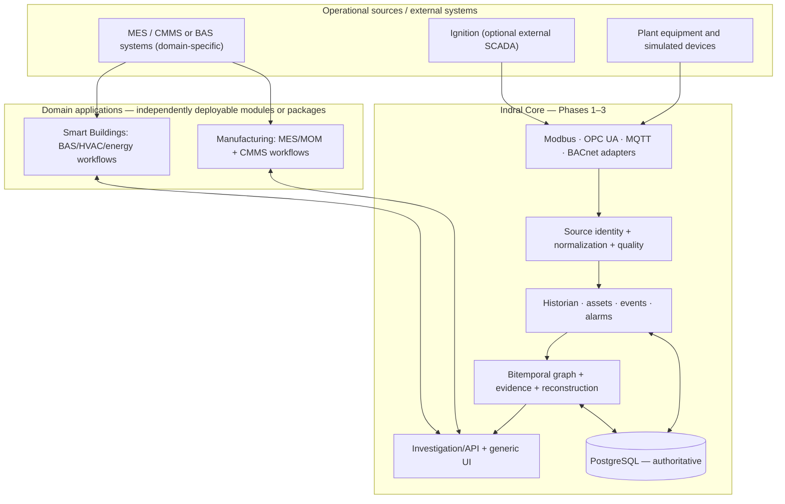

# Core architecture and bounded contexts

**Status:** Design baseline. Component names and interfaces are conceptual, not prescribed service/process boundaries.

## Logical flow

The diagram represents dependency direction, not necessarily synchronous calls, independent microservices, or a requirement to route all external APIs through protocol adapters. Business connectors can use HTTP or other integration mechanisms and must still translate to shared identities and evidence contracts.

## Core-owned concepts

| Capability | Core responsibility | Must **not** assume |
|---|---|---|
| Source and connection | Endpoint configuration, protocol identity, health, capabilities, diagnostics | PLC-only topology; BACnet == HVAC |
| Asset and relation | Stable IDs, typed edges, containment/dependency primitives | ISA-95 hierarchy mandatory; zones/production lines hardcoded |
| Telemetry | Measurements, units, observation/receipt times, source quality, archival | All signals have a trusted source timestamp |
| Events and alarms | Generic occurrences, transitions, severity, acknowledgment metadata | OEE/downtime reason code or comfort threshold semantics |
| Historian | Historical queries, retention, duplicates, corrections, provenance | Production/occupancy calendar |
| Temporal intelligence | Bitemporal entities/edges, evidence ledger, historic reconstruction | Any particular manufacturing or building ontology |
| UI and APIs | Generic asset/history/alarm/timeline/graph views and query endpoints | React; MES or BAS-specific dashboards |

## Domain-owned concepts

**Manufacturing** interprets generic signals and asset relationships in ISA-95-informed workflows: site/area/line/station, production and work orders, material genealogy, quality, downtime/OEE, and maintenance. It owns MES/CMMS API semantics.

**Smart Buildings** interprets the same primitives for building/floor/space/zone, AHU/VAV, point schedules, setpoints, comfort/energy and facility work orders. It owns Brick/Haystack-inspired mappings if adopted. A BACnet point alone is not a building-domain entity.

A new domain may introduce its own relational tables, external API endpoints, scheduled jobs and UI screens. It **cannot** alter the authoritative Core time meaning or overwrite generic source evidence.

## Ownership and integration

- Core records canonical asset IDs separately from protocol-native address/object IDs, using explicit source-to-asset mappings with provenance and effective history.
- Domain services attach domain facts and relationships to canonical IDs through documented APIs/repositories.
- Persist raw-source references and normalized results; retain enough native metadata to re-interpret an observation after mapping changes.
- Core holds authoritative relational and temporal records in PostgreSQL. Quervant can later index projections, but cannot silently become the source of truth.
- Domain-specific rules can classify or correlate events, but must distinguish asserted facts from derived results. Inference and investigation layers should expose evidence and rules used.

## Implementation posture

Start as a modular application, not an unnecessarily distributed service mesh. Use Python/FastAPI, PostgreSQL and server-rendered Jinja2/htmx; ECharts and Cytoscape.js provide interactive visualizations. Add IPC/RPC boundaries only for demonstrated operational requirements. Keep simulator code and domain rules outside Core. This architecture is intentionally suitable for both local and AWS-backed deployment later.
