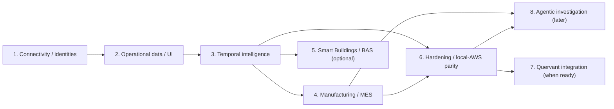

# Indral roadmap — approved planning sequence

**Baseline:** 2026-10-31. **Status:** product-level phases, not implementation PR specifications.

## Dependency overview

Phases 1–3 are **Core**. Phase 4 is the first domain. Phase 5 is optional and **does not gate Phase 6, 7 or 8**. Phase 7 does not gate Phase 8, and vice versa. Phase 6 can also harden the optional building module when that module exists, but its baseline exit targets Core and Manufacturing.

## Phases and deliverables

| Phase | Outcome | Major features | Evidence of completion |
|---|---|---|---|
| **1 — Connectivity and operational modeling** | Generic, testable OT ingestion | Stable source/asset identities; Modbus TCP, OPC UA, MQTT, BACnet/IP; adapters/config/health; normalizer; synthetic fixtures; Ignition connectivity | Four protocol fixtures readable, native metadata preserved, failure cases surfaced |
| **2 — Operational data platform** | Usable local monitoring/historian | PostgreSQL historian, generic state/event/alarm logs, operator UI, trends, quality, ingestion recovery, Ignition interoperability | Live + historical measurements and alarms across all adapters; failures/replay covered |
| **3 — Temporal intelligence** | Standalone Indral Core | Bitemporal asset/edge history, evidence and provenance, incident timelines, historical graph, Operational Time Travel, generic investigation APIs | Deterministic T/K reconstruction; late arrivals and corrections correctly differentiated |
| **4 — Manufacturing** | MES-adjacent operational application | ISA-95-informed equipment/production context, orders, OEE/downtime, quality, lot genealogy, simulated MES/CMMS connectors | End-to-end manufacturing execution + evidence-backed production incident |
| **5 — Smart Buildings (optional)** | Separate BAS-oriented domain | Spaces/zones and equipment, BAS semantics, HVAC/energy/comfort scenario, facility maintenance, building investigations | Standalone building scenario reuses unmodified Core semantics |
| **6 — Production-oriented hardening and deployment** | Reliable local + AWS-hosted application | OT network security, RBAC/credentials, monitoring, backup/restore, fault injection, safe edge/cloud connectivity, deployment parity | Baseline Core + Manufacturing pass equivalent local/AWS end-to-end tests |
| **7 — Quervant (deferred)** | Search and future ontology augmentation | Indexed event/asset/maintenance retrieval, source-consistent projection, inference as Quervant matures | Improved retrieval with a PostgreSQL-only fall-back; no loss of temporal consistency |
| **8 — Agentic investigation (deferred)** | AI-assisted, evidence-grounded workflows | Bedrock, AgentCore, LangGraph; Strands evaluation; read-only tools, evaluation, human review | Repeatable investigation tasks, verified citations, failures and uncertainty surfaced |

## Phase gate design

### Stage A: Core (Phases 1–3)
- Uses **no domain-only tables or model vocabulary** to deliver its generic user workflows.
- Does not depend on Quervant, Bedrock, or remote AWS managed services.
- Contains deterministic fixtures and automated evidence-correctness tests.

### Stage B: first usable industrial product (Phase 4)
- A realistic factory process (including failure) goes from protocol signal to historian, production execution context, maintenance integration and historical investigation.
- OEE and material lineage calculations reproducible from test facts.
- Manufacturing semantics remain in its domain module.

### Stage C: maturity (Phase 6)
- Prove recovery, security and local/AWS parity before describing the platform as deployment-ready.
- Phase 5 is independently optional; do not block Manufacturing or Core completion on HVAC/BAS.

## Cross-cutting requirements from the first PR

Read-only by default; deterministic test data; error/quality reporting; source and time provenance; repeatable local deployment; no React; explicit migrations; graceful failures; no silent data-loss claims. These are not deferred until Phase 6.

## Learning progression (reference topics)

See the **[curated learning-resource guide](../learning/RESOURCES.md)** for phase-by-phase free and affordable courses, tutorials, training providers, specific skills, descriptions and practice exercises. **OT Security is cross-cutting from Phase 1**: the [dedicated OT Security curriculum](../learning/OT_SECURITY.md) covers CISA/INL courses, ISA/IEC 62443, protocol security/PKI, MITRE ATT&CK for ICS, detection and incident response. Phase 6 completes integrated hardening; it is not the first security work.

- **P1:** industrial networking, Modbus, OPC UA, MQTT, BACnet and ISA-95 equipment/system boundaries.
- **P2:** SCADA/historian concepts, alarm and event management, signal quality, Ignition.
- **P3:** event sourcing vs bitemporal persistence, valid vs knowledge time, evidence provenance, incident reconstruction.
- **P4:** ISA-95/MES/MOM, production execution, OEE/six big losses, genealogy, quality, ERP/MES/CMMS integration.
- **P5:** BAS fundamentals, Brick/Haystack models, HVAC systems, energy and facility maintenance.
- **P6:** NIST OT security guidance, edge/cloud operations, observability and resilience.
- **P7:** Quervant graph and ontology design docs, semantic indexing.
- **P8:** AWS Certified Generative AI Developer – Professional domains, Bedrock/AgentCore and agent evaluations.

The [learning-resource guide](../learning/RESOURCES.md) includes online courses, hands-on tutorials, reference reading, access/cost notes and practical Indral exercises. Listed resources are not mandatory implementation dependencies.

## Initial next PRs — proposals, not an approved breakdown

1. P1 technical contract: canonical IDs, source/observation schema, adapter capability matrix and error states.
2. Deterministic fixture and first vertical protocol slice with smoke/integration tests.
3. Remaining protocol slices, each with native metadata and fault tests.
4. P2 historian + generic UI; then Phase 3 bitemporal schema and historical reconstruction.

Do not start coding against this document alone when details remain undecided; each implementation PR needs explicit interfaces, migration steps and acceptance tests.
